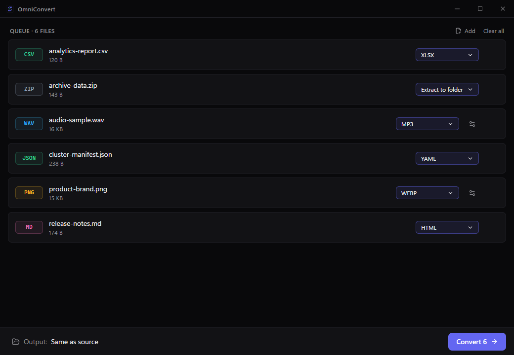
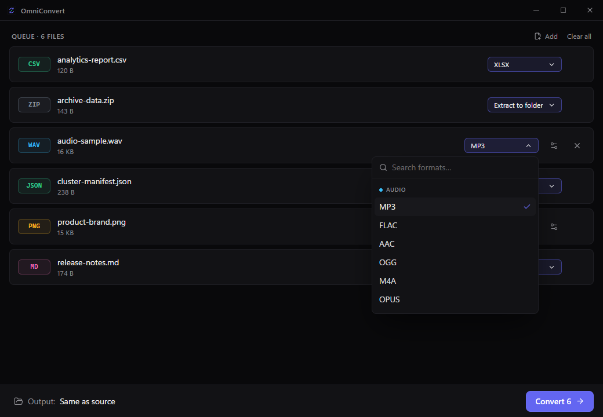
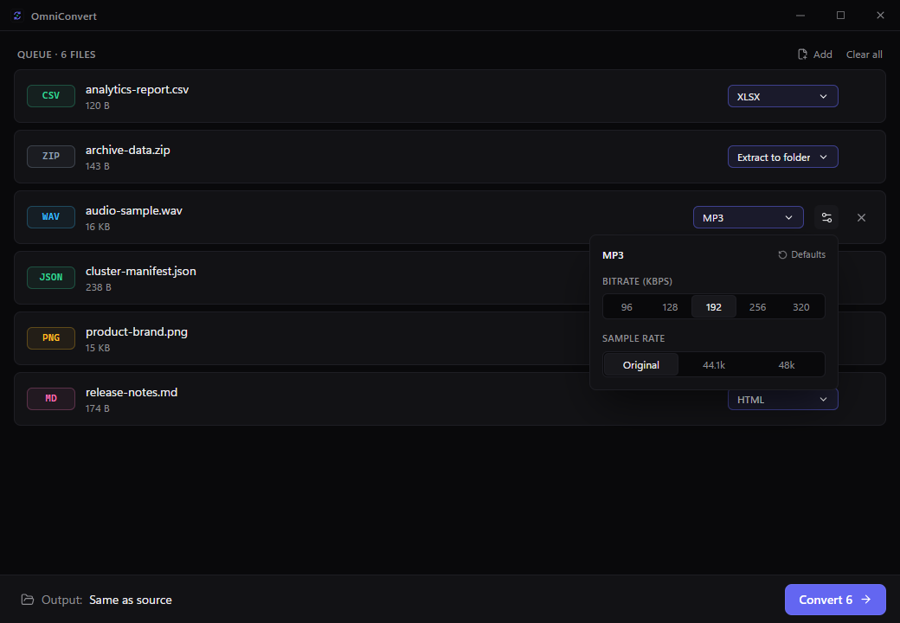
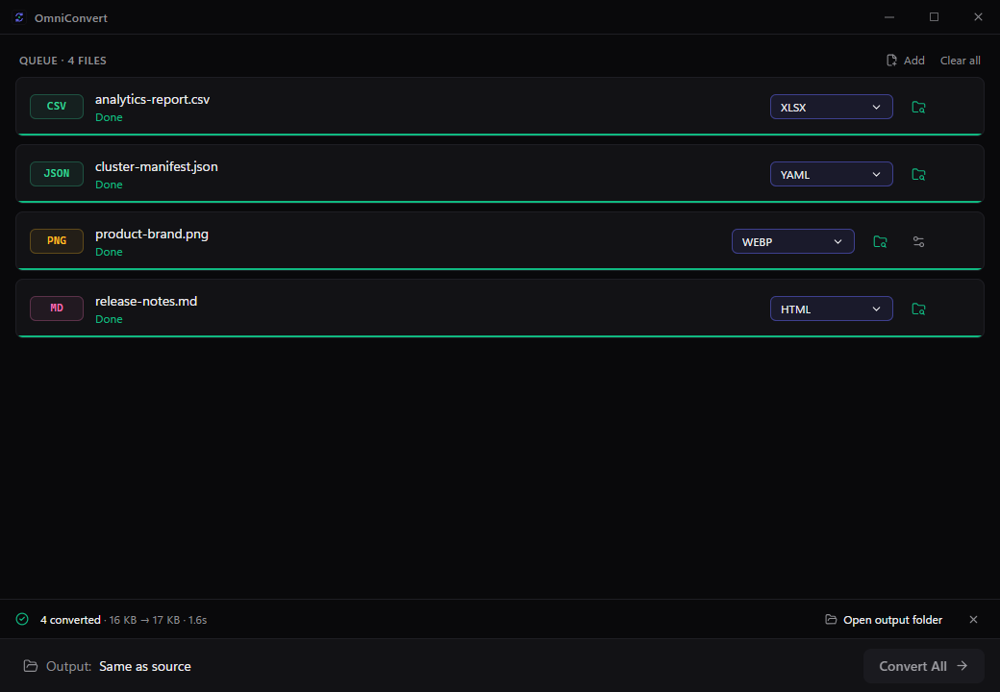
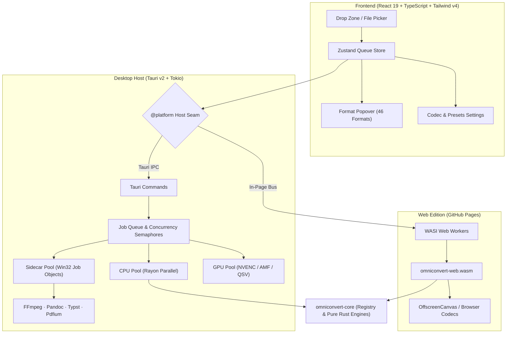

<div align="center">

  

  # OmniConvert

  **High-performance, 100% offline universal file converter for Windows and the Web.**

  [](https://github.com/projectGloria/OmniConvert)
  [](https://projectgloria.github.io/OmniConvert/)
  [](https://www.rust-lang.org/)
  [](https://tauri.app/)

</div>

<p align="center">
  
</p>

---

### Quick Links

- [About](#about)
- [Key Features](#key-features)
- [Supported Formats](#supported-formats)
- [Screenshots](#screenshots)
- [How It Works](#how-it-works)
- [Installation](#installation)
- [Usage](#usage)
- [Building from Source](#building-from-source)
- [License & Credits](#license--credits)

---

## About

OmniConvert is a desktop and browser utility designed to convert video, audio, images, documents, spreadsheets, data structures, and archives without uploading anything to a remote server. Built with a unified pure-Rust engine core, OmniConvert ships as an ultra-fast Windows x64 desktop application powered by Tauri v2 and as a client-side WebAssembly application running in Web Workers.

All file conversions execute locally on your hardware. Your files, documents, and credentials never touch a cloud service, telemetry pipe, or third-party API.

---

## Key Features

- **100% Offline & Private:** Zero network requests at runtime. All transformations happen locally using Rust and sandboxed sidecar engines.
- **Hardware Acceleration:** Automatic hardware encoding detection (NVIDIA NVENC, AMD AMF, Intel QSV) for video and audio transcoding with automatic CPU fallback.
- **Crash-Resilient Processing:** Atomic output writes via temporary `.omni-part` files ensure incomplete conversions never leave corrupted outputs. Sidecars are bound to Win32 Job Objects with `KILL_ON_JOB_CLOSE` to eliminate orphaned processes.
- **46 Formats Across 6 Categories:** Unified format detection and conversion across Video, Audio, Images, Documents, Spreadsheets/Data, and Archives.
- **Single Source of Truth:** The Rust registry detects formats via byte sniffing and traits, preventing impossible conversion targets from ever reaching the user interface.
- **Zero-Clutter Settings:** Granular control over bitrates, sample rates, CRF quality, resolution limits, and lossless compression presets only appear when relevant to the chosen target.
- **Dual-Target Architecture:** Compile once into a Windows native app with complete sidecar capabilities, or to a WASI (`wasm32-wasip1`) bundle for in-browser client-side execution.

---

## Supported Formats

OmniConvert handles 46 file formats across 6 distinct categories:

| Category | Supported Formats |
|:---|:---|
| **Video** | MP4, MKV, MOV, AVI, WEBM, FLV *(Hardware NVENC / AMF / QSV, GIF extraction, Frame dump)* |
| **Audio** | MP3, WAV, FLAC, AAC, OGG, M4A, OPUS *(Audio extraction from video)* |
| **Image** | PNG, JPG, WEBP, AVIF, ICO, BMP, TIFF, GIF, SVG *(Input rasterization)* |
| **Document** | PDF, DOCX, Markdown, HTML, TXT, RTF, EPUB *(Pandoc + Typst layout engine, Pdfium text/image extraction)* |
| **Data & Spreadsheets** | XLSX, XLS *(read-only)*, ODS *(read-only)*, CSV, TSV, JSON, YAML, TOML, XML, Markdown Tables |
| **Archive** | ZIP, 7Z, TAR, GZ, TGZ, XZ, TXZ *(Decompress, Repack, Extract)* |

> [!NOTE]
> PDF layout analysis and raster-to-vector tracing are deliberately excluded to guarantee 100% offline fidelity and deterministic output quality.

---

## Screenshots

<p align="center">
  
  <br /><em>Queue View: Multi-format batch with detected extensions, custom target dropdowns, and live actions.</em>
</p>

<p align="center">
  
  <br /><em>Format Picker: Searchable popover organized by category groups with single-click target assignment.</em>
</p>

<p align="center">
  
  <br /><em>Custom Settings: Context-aware parameters for audio bitrates, sample rates, video codecs, and compression.</em>
</p>

<p align="center">
  
  <br /><em>Batch Complete: Live status indicators, file size comparisons, execution duration, and direct Explorer shortcuts.</em>
</p>

---

## How It Works

OmniConvert separates UI presentation from execution through a platform abstraction seam (`@platform`). The same React interface drives both the Tauri desktop host and the WASI web environment.



- **Desktop Shell (`src-tauri`):** Manages concurrent processing pools (CPU, GPU, and sidecar semaphores), Win32 Job Object isolation, and hardware probes.
- **Pure-Rust Core (`crates/core`):** Houses format detection, compatibility matrix logic, image transforms, archive manipulation, and structured tabular/tree data engines.
- **Web Edition (`crates/web`):** Compiles the core engines to `wasm32-wasip1`, mounting input files into a virtual filesystem in Web Workers for browser conversion.

---

## Installation

### Desktop Edition (Windows x64)

1. Download the latest installer (`.exe` NSIS installer or `.msi` package) from the [Releases](https://github.com/projectGloria/OmniConvert/releases) page.
2. Run the installer and launch **OmniConvert**.
3. No external tools, codecs, or network connections are required; all conversion engines and runtimes are bundled.

### Web Edition

You can test pure-Rust conversions (images, structured data, archives) directly in your browser without installation:

👉 **[Launch OmniConvert Web](https://projectgloria.github.io/OmniConvert/)**

---

## Usage

### 1. Drag & Drop Files
Drag one or more files directly into the window, or click **Browse files** (<kbd>Ctrl</kbd> + <kbd>O</kbd>).

### 2. Choose Output Format
- Click the target pill to open the format search popover.
- Select your desired format.
- Click **Apply to all [ext]** to assign the same target to matching files in the batch.

### 3. Customize Conversion Settings *(Optional)*
- Click the **Gear icon** next to supported targets to configure audio bitrates, video hardware encoders, frame rates, or compression quality.

### 4. Convert & Open
- Click **Convert All** (<kbd>Ctrl</kbd> + <kbd>Enter</kbd>).
- When finished, click the folder icon to reveal converted files directly in Windows Explorer.

---

## Building from Source

### Prerequisites

- **OS:** Windows 10/11 (x64)
- **Node.js:** v22.0.0 or later (`node -v`)
- **Rust Toolchain:** v1.93 or later (`rustc -V`)
- **WASM Target:** `wasm32-wasip1` (`rustup target add wasm32-wasip1`)
- **Build Tools:** Visual Studio 2022 C++ Build Tools

### 1. Clone & Install Dependencies

```powershell
git clone https://github.com/projectGloria/OmniConvert.git
cd OmniConvert
npm ci
```

### 2. Fetch Verified Sidecars (One-time setup)

Downloads and verifies pinned hashes for `ffmpeg`, `ffprobe`, `pandoc`, `typst`, and `pdfium.dll`:

```powershell
npm run sidecars
```

### 3. Run Development Server

```powershell
# Desktop App (Vite on :1420 + Rust / Tauri backend)
npm run tauri dev

# Web Edition (builds WASM and runs Vite on :1430)
npm run build:wasm
npm run dev:web
```

### 4. Build Production Binaries

```powershell
# Build Desktop NSIS & MSI installers (src-tauri/target/release/bundle/)
npm run tauri:build

# Build Web Edition for static hosting (dist-web/)
npm run build:web
```

### 5. Verification Suite

Run the repository verification suite (TypeScript checks, 200-line module limits, Clippy lints, and Cargo unit tests):

```powershell
npm run verify
```

---

## License & Credits

OmniConvert core codebase is open-source.

### Bundled Third-Party Components & Licenses

The desktop installer bundles verified binaries of open-source projects:
- **FFmpeg & FFprobe:** Licensed under [GPLv3](https://www.gnu.org/licenses/gpl-3.0.html)
- **Pandoc:** Licensed under [GPLv2+](https://www.gnu.org/licenses/gpl-2.0.html)
- **Typst:** Licensed under [Apache-2.0](https://www.apache.org/licenses/LICENSE-2.0)
- **Pdfium:** Licensed under the [Chromium BSD-style license](https://pdfium.googlesource.com/pdfium/)

*(Distributing installers that include GPL-licensed binaries carries corresponding source availability obligations.)*
